# Figures from the manuscript

This page places the manuscript figures in one sequence so that readers can move from the forecasting setup to the model architecture, predictive evaluation, component analysis, and intervention scenarios.

## Fig. 1. Schematic diagram of the model prediction timeline

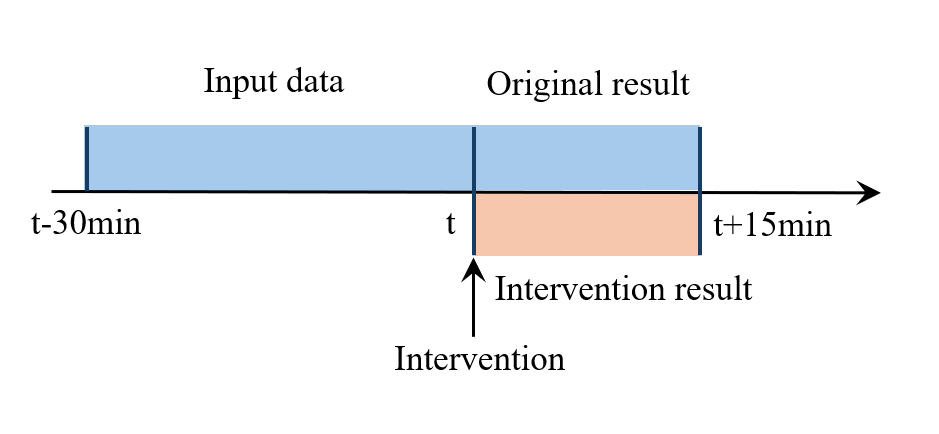

The blue segment is the 30-minute historical input window. At the decision time, a predefined future control sequence is supplied to the model, which projects physiological states over the following 15 minutes.

## Fig. 2. Structure of PDCAN

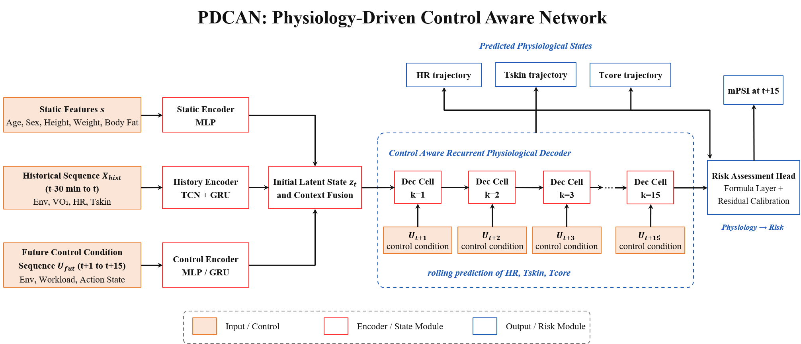

PDCAN combines static worker features, historical physiological and environmental states, and future control conditions. Its outputs are HR, skin-temperature, and core-temperature trajectories, together with the final mPSI estimate.

## Fig. 3. PDCAN encoder

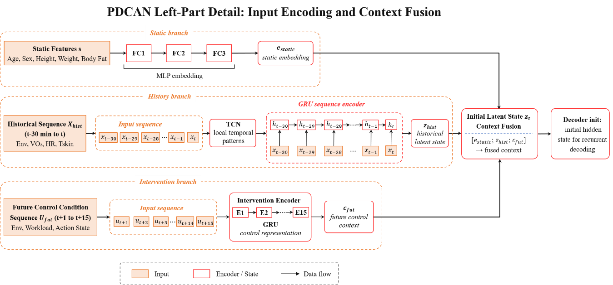

The encoder forms a static embedding, extracts local temporal patterns with a TCN and GRU, and represents the future control sequence before fusing the three information streams.

## Fig. 4. Control-aware recurrent physiological decoder

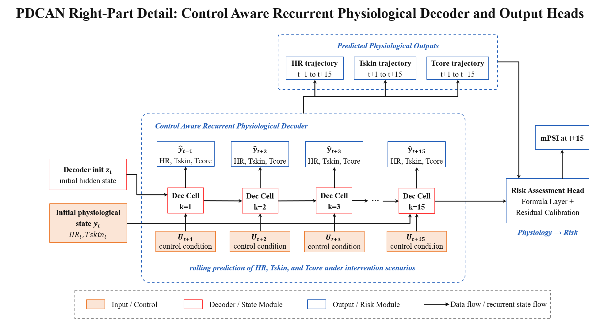

The decoder rolls forward across the 15-minute horizon using the supplied control sequence and produces the multivariable physiological trajectories used by the risk head.

## Fig. 5. Heart-rate MAE across prediction steps

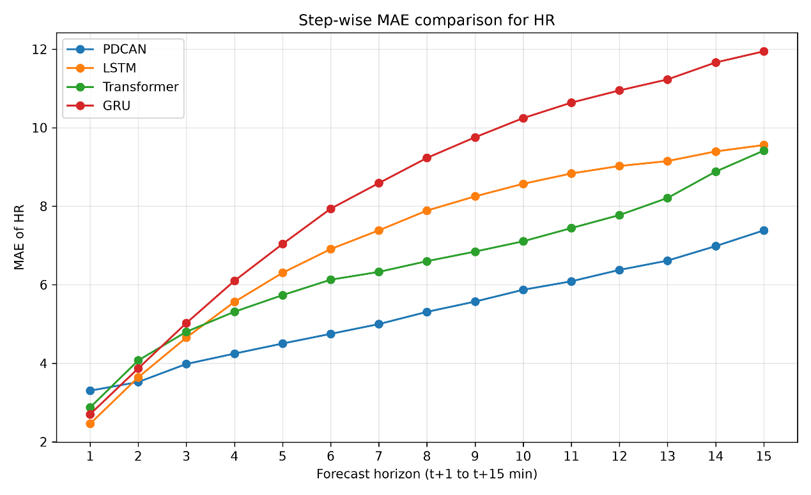

This figure compares step-wise heart-rate errors for PDCAN, LSTM, Transformer, and GRU.

## Fig. 6. Skin-temperature MAE across prediction steps

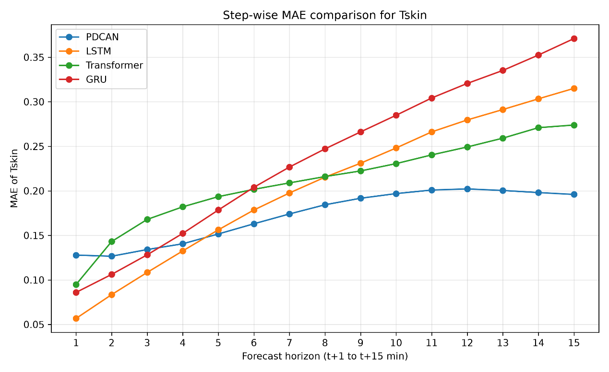

This figure compares the skin-temperature forecasting errors across the 15-minute horizon.

## Fig. 7. Core-temperature MAE across prediction steps

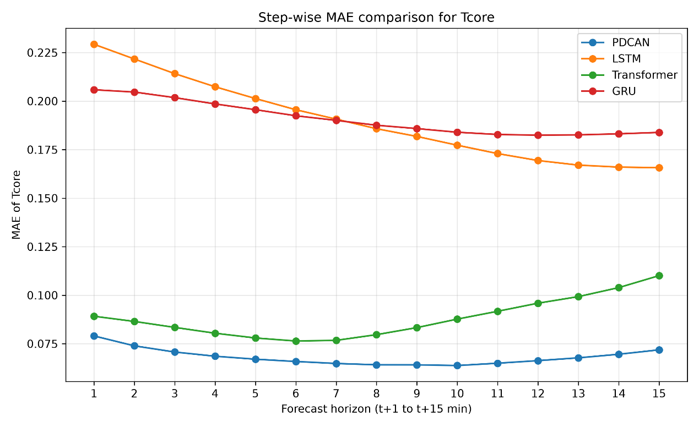

This figure compares the core-temperature forecasting errors across the 15-minute horizon.

## Fig. 8. Predicted versus observed mPSI

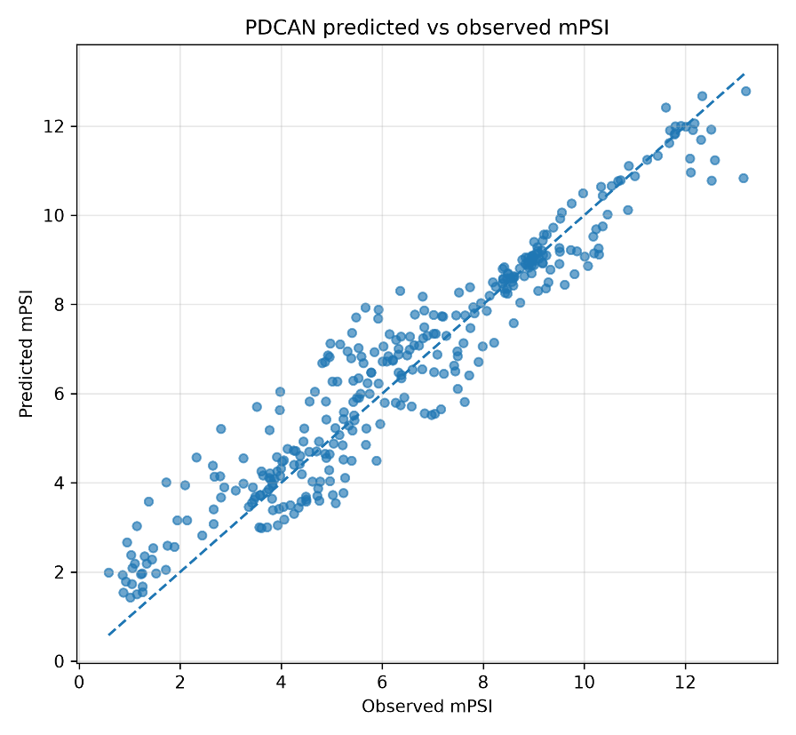

The scatter plot shows the agreement between predicted and observed final mPSI values in the fixed test set.

## Fig. 9. Distribution of mPSI residuals

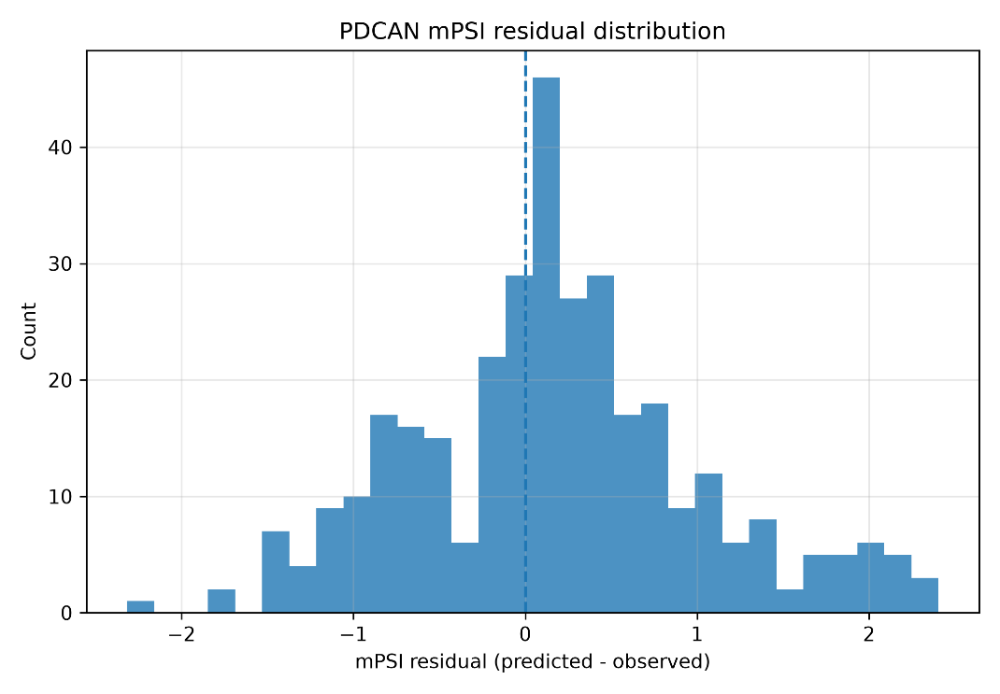

The residual distribution provides a complementary view of the final mPSI prediction error.

## Fig. 10. Individual and median physiological trajectories under control-sequence scenarios

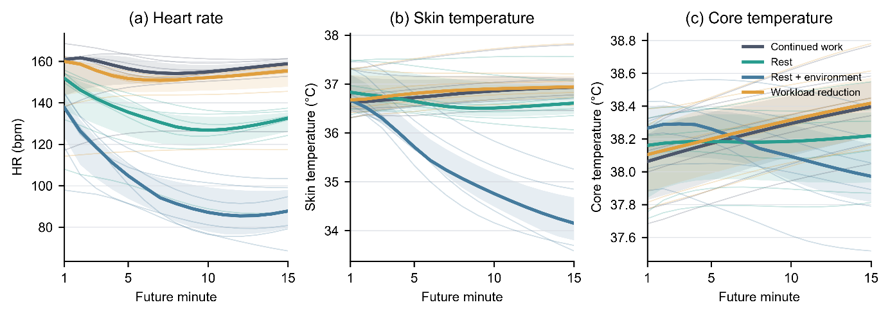

The figure compares predicted HR, skin temperature, and core temperature under continued work, rest, rest plus environmental improvement, and observed workload reduction for the six representative transition blocks.

## Fig. 11. Predicted final mPSI across control-sequence scenarios

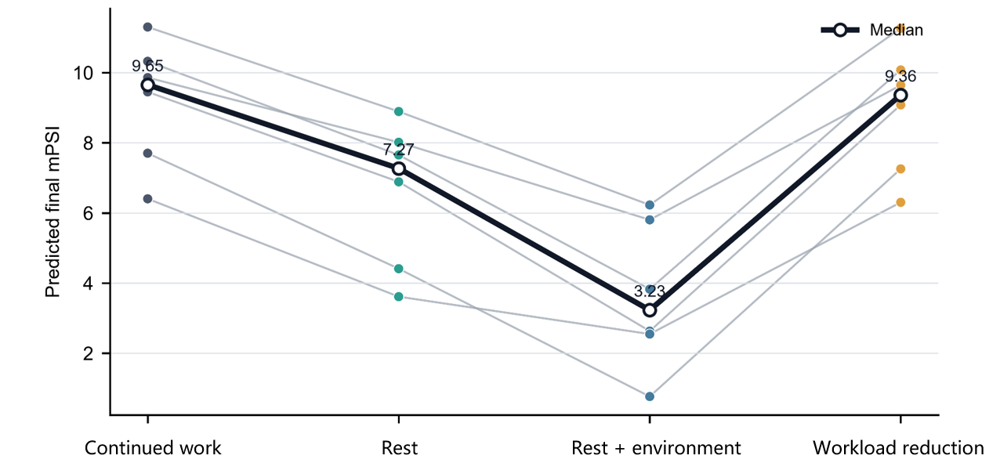

The paired lines show the projected change in final mPSI for each representative transition block. The alternative scenarios are model projections; the observed workload-reduction sequence is the factual reference.

